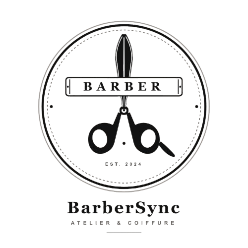
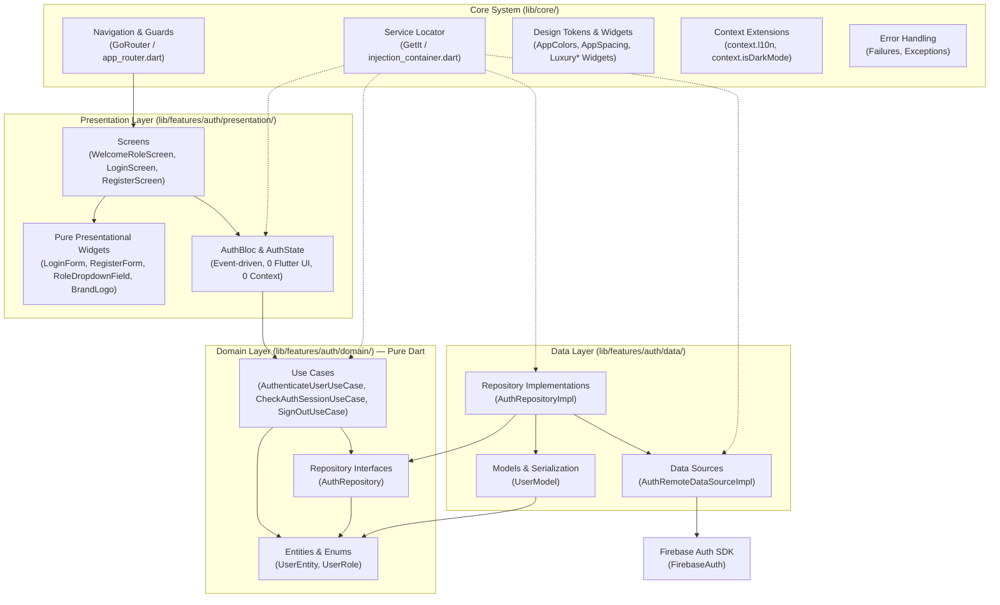
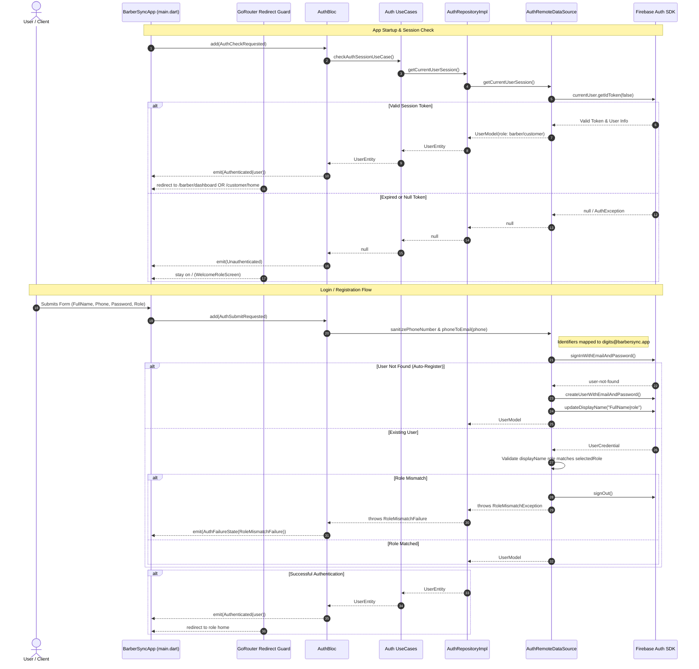

# BarberSync 💈

> **The Modern Gentleman's Grooming Platform** — A production-grade, offline-first barbershop booking mobile application engineered with Flutter, Clean Architecture, BLoC State Management, and Firebase Authentication.

[](https://flutter.dev)
[](https://dart.dev)
[](https://blog.cleancoder.com/uncle-bob/2012/08/13/the-clean-architecture.html)
[](https://bloclibrary.dev)
[](https://firebase.google.com)
[](https://pub.dev/packages/sqflite)
[](https://github.com)

---

## 1. Visual Identity & Brand Assets Showcase

BarberSync embodies an editorial, luxury grooming aesthetic combining **Warm Cream** surfaces (`#F7EBDF`) with high-contrast **Obsidian Black** ink and accents (`#121212`), paired with a warm bronze/leather secondary tone (`#A17653`).

| Mode | Active Surface | Accent / Ink | Brand Asset | Preview |
| :--- | :--- | :--- | :--- | :---: |
| **Light Mode** *(Default)* | Warm Cream (`#F7EBDF`) | Obsidian Black (`#121212`) | `assets/images/logoApp-withOutBackground.png` |  |
| **Dark Mode** | Obsidian Black (`#121212`) | Warm Cream (`#F7EBDF`) | `assets/images/darkMode_logo.jpg` |  |

---

## 2. Launcher Icon, Native Splash & Asset Pipeline

The branding pipeline guarantees zero visual flash and consistent styling across cold app starts, platform theme changes, and screen transitions.

### 2.1 Launcher Icon Configuration (`flutter_launcher_icons`)
Defined in `pubspec.yaml`, the launcher icon pipeline generates adaptive Android and iOS icons grounded in the Warm Cream background:
```yaml
flutter_launcher_icons:
  android: true
  ios: true
  image_path: "assets/icons/app_icon.png"
  adaptive_icon_background: "#f7ebdf"
  adaptive_icon_foreground: "assets/icons/app_icon.png"
```

### 2.2 Android 12+ Native Splash (`flutter_native_splash`)
Configured to preserve brand continuity from the OS window bootloader through initial token validation:
```yaml
flutter_native_splash:
  color: "#f7ebdf"
  image: "assets/images/nativeSplash.jpg"
  color_dark: "#f7ebdf"
  image_dark: "assets/images/nativeSplash.jpg"
  android_12:
    color: "#f7ebdf"
    image: "assets/images/nativeSplash.jpg"
    icon_background_color: "#f7ebdf"
    color_dark: "#f7ebdf"
    image_dark: "assets/images/nativeSplash.jpg"
    icon_background_color_dark: "#f7ebdf"
```
In `main.dart`, splash removal is synchronized with `AuthBloc`:
1. `FlutterNativeSplash.preserve(widgetsBinding: widgetsBinding);` halts the native screen.
2. An auth stream subscription monitors `AuthState`.
3. When `AuthState` resolves past `AuthInitial` / `AuthCheckingSession` (to either `Authenticated` or `Unauthenticated`), `FlutterNativeSplash.remove()` runs on the next microtask frame.

### 2.3 Centralized Theme-Aware Asset Architecture (`BrandLogo`)
Logo assets are centralized in `AppAssets` (`lib/core/constants/app_constants.dart`):
- `AppAssets.lightLogo = 'assets/images/logoApp-withOutBackground.png'`
- `AppAssets.darkLogo = 'assets/images/darkMode_logo.jpg'`

The `BrandLogo` widget (`lib/core/widgets/brand_logo.dart`) automatically reads `Theme.of(context).brightness` and selects the appropriate asset with uniform `ClipRRect` and sizing. Direct static references to logo image paths in UI screens are forbidden by project rules.

---

## 3. System & Clean Architecture Diagrams

The application strictly enforces **Clean Architecture** boundaries with inverted dependencies and isolation between data sources, business logic, and presentation.

### 3.1 Clean Architecture & Layer Dependency Flow



### 3.2 Authentication, Role-Guard & Session Persistence Sequence



---

## 4. Tech Stack & Installed Packages

All packages declared in `pubspec.yaml` are pinned to compatible production versions:

| Package | Version | Layer / Responsibility | Exact Purpose in BarberSync |
| :--- | :--- | :--- | :--- |
| **`flutter`** | SDK | All | Flutter SDK framework. |
| **`flutter_localizations`** | SDK | Presentation / Core | Official localization delegate providing locale parsing and bidirectional support. |
| **`cupertino_icons`** | `^1.0.8` | Presentation | iOS-style iconography fallback where required. |
| **`flutter_bloc`** | `^8.1.6` | Presentation | Predictable BLoC/Cubit state management with granular `BlocBuilder` and `BlocConsumer`. |
| **`get_it`** | `^7.7.0` | Core / DI | Service locator registering DataSources, Repositories, UseCases, and BLoCs. |
| **`go_router`** | `^14.2.0` | Core / Navigation | Declarative routing with session state refresh streams and cross-role guard redirects. |
| **`dio`** | `^5.4.3+1` | Data / Network | HTTP client configured with retry interceptors, auth headers, and token refresh. |
| **`sqflite`** | `^2.3.3+1` | Data / Persistence | SQLite database engine backing offline-first local cache for bookings and profiles. |
| **`path`** | `^1.9.0` | Data / Storage | Cross-platform file and database path manipulation utilities. |
| **`flutter_secure_storage`** | `^9.2.2` | Data / Security | Hardware-backed encrypted keychain/keystore storage for sensitive session tokens. |
| **`shared_preferences`** | `^2.2.3` | Data / Settings | Key-value store for app-level configurations and lightweight user preferences. |
| **`connectivity_plus`** | `^6.0.3` | Core / Network | Real-time network reachability monitoring for sync coordination. |
| **`equatable`** | `^2.0.5` | Domain / Presentation | Value-based equality comparisons for BLoC states, events, entities, and models. |
| **`intl`** | `0.20.2` | Core / Localization | Date, currency, number formatting, and message translation utilities. |
| **`google_fonts`** | `^8.2.1` | Presentation / Theme | Dynamic loading of brand typography (`Newsreader` serif and `Plus Jakarta Sans`). |
| **`flutter_native_splash`** | `^2.4.1` | Core / Platform | Native Android 12+ and iOS launch splash screen generator and API controller. |
| **`firebase_core`** | `^5.1.0` | Data / Infrastructure | Core Firebase initialization bridge across mobile platforms. |
| **`firebase_auth`** | `^7.0.1` | Data / Auth | Secure Firebase Authentication SDK with identity token management. |
| **`flutter_test`** | SDK | Test | Unit, widget, and mock testing infrastructure. |
| **`flutter_lints`** | `^5.0.0` | Dev Tooling | Official Flutter community style and analyzer linting rules. |
| **`flutter_launcher_icons`** | `^0.13.1` | Dev Tooling | CLI generator for multi-density Android and iOS application launcher icons. |

---

## 5. Project Directory Structure

```
barber-app/
├── .idx/
│   └── guidelines.md                  # Project engineering constitution & guidelines
├── .cursorrules                       # AI/Engineer development constraints & rules
├── android/                           # Native Android project configuration (Kotlin 2.3.0)
├── assets/
│   ├── appScreenDesign/               # High-fidelity reference screen designs
│   ├── fonts/                         # Custom font assets
│   ├── icons/                         # App icon masters (app_icon.png)
│   └── images/                        # Brand logos, splashes, and dark mode emblem
├── lib/
│   ├── core/                          # Cross-cutting foundational modules
│   │   ├── constants/                 # Spacing, sizes, opacity, assets, APIs
│   │   ├── database/                  # SQLite tables & database helper
│   │   ├── di/                        # GetIt dependency injection container
│   │   ├── error/ & errors/           # Typed domain failures & data exceptions
│   │   ├── extensions/                # BuildContext extensions (l10n, colors, isDarkMode)
│   │   ├── network/                   # Dio client, network info, interceptors
│   │   ├── router/                    # AppRoutes constants & GoRouter configuration
│   │   ├── settings/                  # AppSettingsController & AppSettingsScope
│   │   ├── storage/                   # Secure storage services
│   │   ├── theme/                     # AppColors, AppTextStyles, AppTheme
│   │   ├── utils/                     # Responsive layout utilities
│   │   └── widgets/                   # Reusable Luxury design system components
│   ├── features/
│   │   └── auth/                      # Clean Architecture Authentication Feature
│   │       ├── data/
│   │       │   ├── datasources/       # AuthRemoteDataSource (Firebase Auth SDK)
│   │       │   ├── models/            # UserModel (Firebase User mapping & parsing)
│   │       │   └── repositories/      # AuthRepositoryImpl (Failure mapping)
│   │       ├── domain/
│   │       │   ├── entities/          # UserEntity, UserRole enum
│   │       │   ├── repositories/      # AuthRepository contract
│   │       │   └── usecases/          # Authenticate, CheckSession, SignOut UseCases
│   │       └── presentation/
│   │           ├── bloc/              # AuthBloc, AuthEvent, AuthState
│   │           ├── screens/           # WelcomeRoleScreen, LoginScreen, RegisterScreen
│   │           ├── utils/             # Failure-to-localized-message mapper
│   │           └── widgets/           # LoginForm, RegisterForm, RoleDropdownField, etc.
│   ├── l10n/                          # ARB translation sources & generated delegates
│   │   ├── app_ar.arb                 # Arabic localized strings
│   │   └── app_en.arb                 # English localized strings
│   ├── firebase_options.dart          # Platform Firebase configuration
│   └── main.dart                      # App entrypoint & BarberSyncApp root
└── test/                              # Comprehensive test suite (36 tests)
    ├── features/auth/
    │   ├── data/                      # AuthRemoteDataSource unit & failure mapping tests
    │   ├── presentation/
    │   │   ├── bloc/                  # AuthBloc state transitions & GoRouter guard tests
    │   │   └── screens/               # LoginScreen & RegisterScreen widget/flow tests
    └── widget_test.dart               # Theme default, toggle, brand logo, and welcome tests
```

---

## 6. Core Design System & Reusable Widgets Catalog

### 6.1 Design Tokens

- **8-Point Spatial Grid (`AppSpacing`):**
  - `xs = 4.0`, `sm = 8.0`, `md = 16.0`, `lg = 24.0`, `xl = 32.0`, `xxl = 48.0`
  - Canonical gaps: `AppSpacing.verticalSm`, `AppSpacing.verticalMd`, `AppSpacing.verticalXl`, `AppSpacing.horizontalSm`, `AppSpacing.horizontalMd`.
  - Canonical padding: `AppSpacing.screenPadding`, `AppSpacing.cardPadding`, `AppSpacing.dialogPadding`.
- **Color Palette (`AppColors`):**
  - `primary = Color(0xFF121212)` — Obsidian Black ink and dark mode background.
  - `cream = Color(0xFFF7EBDF)` — Warm Cream primary light surface.
  - `secondary = Color(0xFFA17653)` — Warm bronze accent for focus borders and indicators.
  - `tertiary = Color(0xFF4A4643)` — Subtle secondary label text.
  - `cardLight = Color(0xFFFAF7F5)` / `cardDark = Color(0xFF1E1E1E)`.
  - `borderLight = Color(0xFFE5DDD8)` / `borderDark = Color(0xFF2E2C2A)`.
  - `error = Color(0xFFD32F2F)` / `success = Color(0xFF2E7D32)`.
- **Typography (`AppTextStyles`):**
  - Headlines & Titles: Editorial serif via `GoogleFonts.newsreader`.
  - Body & UI Controls: Crisp legibility via `GoogleFonts.plusJakartaSans`.
- **Centralized Context Extensions (`context_extensions.dart`):**
  - `context.l10n`: Fast access to `AppLocalizations`.
  - `context.isDarkMode`: Reads active `ThemeMode` from `AppSettingsScope` with platform fallback.
  - `context.colors`: Fast access to active `ColorScheme`.
  - `context.cardSurface` & `context.borderColor`: Resolves dynamic card background/border colors.
  - `context.toggleTheme()` & `context.toggleLocale()`: Clean event dispatchers without controller boilerplate.

### 6.2 Widgets Catalog

| Widget Name | File Path | Props & Description |
| :--- | :--- | :--- |
| **`BrandLogo`** | `lib/core/widgets/brand_logo.dart` | `size`, `borderRadius`, `fit`. Automatically selects `AppAssets.darkLogo` in dark mode and `AppAssets.lightLogo` in light mode with smooth clipping. |
| **`LuxuryAppBar`** | `lib/core/widgets/luxury_app_bar.dart` | `title`, `currentLanguage`, `onLanguageToggle`, `isDarkMode`, `onThemeToggle`, `showBackButton`, `onBackTap`. Luxury editorial top navigation bar with dynamic icon flip. |
| **`LuxuryPrimaryButton`** | `lib/core/widgets/luxury_buttons.dart` | `text`, `onPressed`, `isLoading`, `isFullWidth`, `prefixIcon`, `trailingIcon`. Elevation-free primary action button adapting to `ColorScheme.primary`. |
| **`LuxurySecondaryButton`**| `lib/core/widgets/luxury_buttons.dart` | `text`, `onPressed`, `isLoading`, `prefixIcon`. Elevated card-surface action button for alternative workflows. |
| **`LuxuryOutlinedButton`** | `lib/core/widgets/luxury_buttons.dart` | `text`, `onPressed`, `height`, `isFullWidth`, `prefixIcon`. Hairline-bordered action button used for secondary CTAs and Sign Out. |
| **`LuxuryTextField`** | `lib/core/widgets/luxury_text_field.dart` | `controller`, `label`, `hintText`, `isPassword`, `validator`, `prefixIcon`. Form field with uppercase floating label, obscure toggle, and focus highlights. |
| **`LuxuryBanner`** | `lib/core/widgets/luxury_banner.dart` | `headline`, `caption`, `icon`, `onAction`. Brand announcement and status container with bronze accents. |
| **`LuxuryAvatar`** | `lib/core/widgets/luxury_avatar.dart` | `image`, `fallbackLabel`, `size`, `onTap`. Rounded avatar component with initials monogram fallback. |
| **`LuxuryBadge`** | `lib/core/widgets/luxury_badge.dart` | `label`, `variant`, `icon`. Status badge for role, booking status, or indicators. |
| **`LuxuryLoader`** | `lib/core/widgets/luxury_loaders.dart` | `size`, `color`. Minimal circular progress indicator themed to brand tokens. |
| **`KpiCard`** | `lib/core/widgets/kpi_card.dart` | `title`, `value`, `changeLabel`, `isPositive`. Dashboard analytics card for barbershop revenue/booking metrics. |
| **`TimelineAppointmentTile`** | `lib/core/widgets/timeline_appointment_tile.dart` | `time`, `clientName`, `service`, `duration`. Timeline appointment card with status indicator. |
| **`WelcomeBrandHeader`** | `lib/features/auth/presentation/widgets/welcome_brand_header.dart` | Displays the 300px theme-aware `BrandLogo`, editorial "BarberSync" headline, and localized tagline. |
| **`RoleSelectionActions`** | `lib/features/auth/presentation/widgets/role_selection_actions.dart` | `onLoginPressed`, `onRegisterPressed`. Vertical CTA group offering primary "Login" and outlined "Create Account". |
| **`LoginHeader`** | `lib/features/auth/presentation/widgets/login_header.dart` | 96px emblem container with subtle shadow, welcome back title, and localized subtitle. |
| **`LoginForm`** | `lib/features/auth/presentation/widgets/login_form.dart` | `onSubmit`, `isLoading`, `errorMessage`, `initialRole`. Pure form handling validation for Name (>= 2 words), Phone (9–15 digits), and Password (>= 6 chars). |
| **`RegisterHeader`** | `lib/features/auth/presentation/widgets/register_header.dart` | 96px emblem container with "Join BarberSync" title and registration subtitle. |
| **`RegisterForm`** | `lib/features/auth/presentation/widgets/register_form.dart` | `onSubmit`, `isLoading`, `errorMessage`, `initialRole`. Pure registration form providing Role selector, Name, Phone, and Password fields. |
| **`RoleDropdownField`** | `lib/features/auth/presentation/widgets/role_dropdown_field.dart` | `selectedRole`, `onChanged`, `enabled`. Dropdown selector between `Customer` (person icon) and `Barber` (scissors icon). |
| **`AuthErrorBanner`** | `lib/features/auth/presentation/widgets/auth_error_banner.dart` | `message`. Red-bordered error container with error icon displaying domain failure explanations. |

---

## 7. Routing & Navigation Map (`GoRouter`)

All routes are defined as constants in `AppRoutes` (`lib/core/router/app_routes.dart`). The router guard in `app_router.dart` continuously inspects `AuthBloc.state`:

| Route Path | Constant | Access Level | Target Screen | Guard Behavior |
| :--- | :--- | :--- | :--- | :--- |
| **`/`** | `AppRoutes.welcome` | Public | `WelcomeRoleScreen` | If `Authenticated`, immediately redirects to role home (`/barber/dashboard` or `/customer/home`). |
| **`/login`** | `AppRoutes.login` | Public | `LoginScreen` | If `Authenticated`, immediately redirects to role home. |
| **`/register`** | `AppRoutes.register` | Public | `RegisterScreen` | If `Authenticated`, immediately redirects to role home. |
| **`/barber/dashboard`** | `AppRoutes.barberDashboard` | **Protected (Barber)** | `LoginPlaceholderScreen` | If `Unauthenticated`, redirects to `/`. If `Authenticated` as `UserRole.customer`, redirected to `/customer/home`. |
| **`/customer/home`** | `AppRoutes.customerHome` | **Protected (Customer)** | `LoginPlaceholderScreen` | If `Unauthenticated`, redirects to `/`. If `Authenticated` as `UserRole.barber`, redirected to `/barber/dashboard`. |

---

## 8. Localization (`l10n`) & Dual-Language Standards

BarberSync provides complete bilingual support with real-time in-app switching:
- **English (`en`)**: Source declared in `lib/l10n/app_en.arb`.
- **Arabic (`ar`)**: Source declared in `lib/l10n/app_ar.arb` (Modern Standard Arabic).

### 8.1 Key Localization Features
- **Zero Hardcoded Strings**: All UI copy, validation messages, and errors are sourced through `AppLocalizations`.
- **Bidirectional Layout (LTR/RTL)**:
  - Layouts strictly employ `EdgeInsetsDirectional`, `AlignmentDirectional`, and `PositionedDirectional`.
  - Iconography (e.g., chevrons and back buttons) mirrors naturally when switching to Arabic.
- **Dynamic Language Toggle**: Managed via `AppSettingsController.toggleLocale()`, accessible via `context.toggleLocale()` or the language chip in `LuxuryAppBar`.

---

## 9. Engineering Constitution & Project Rules

All development adheres to `.idx/guidelines.md` and `.cursorrules`:

1. **Default Theme Rule:** The application MUST always initialize in `ThemeMode.light` with Warm Cream (`#F7EBDF`) surface and Obsidian Black (`#121212`) ink. Never default to `ThemeMode.dark` or `ThemeMode.system`.
2. **Theme-Aware Brand Logo Rule:** Never render a static image path directly. Always use the centralized `BrandLogo` widget (`AppAssets.darkLogo` in dark mode, `AppAssets.lightLogo` in light mode).
3. **Strict Layer Dependency Rule:**
   - `domain` imports NOTHING outside pure Dart and `core/errors`.
   - `data` imports ONLY `domain` and `core`.
   - `presentation` imports ONLY `domain` and `core` (NEVER `data`).
4. **BLoC Purity Rule:** BLoCs and States must NEVER import `package:flutter/material.dart`, `BuildContext`, `GoRouter`, or `AppLocalizations`. State classes expose semantic getters (`isSubmitting`, `activeFailure`) to keep UI predicates concise.
5. **Pure Widget vs. Smart Container Rule:** Form and item widgets inside `presentation/widgets/` must remain decoupled from `BlocProvider` and `context.read<Bloc>()`, receiving primitive state and emitting callbacks. Screens act as the smart containers wiring the BLoC.
6. **UI Context & Boilerplate Rule:** Never repeat `AppLocalizations.of(context)!` or `AppSettingsScope.of(context)` inside screen `build()` methods. Always use `context.l10n`, `context.isDarkMode`, `context.colors`.
7. **Clean Code & Zero Explanatory Doc-Comments:** No superfluous doc-comments or inline comments. Code is written to be clean, self-documenting, and maintainable.
8. **Overflow Immunity:** Every scrollable or form screen MUST use `SafeArea`, `LayoutBuilder`, and `SingleChildScrollView` with `ConstrainedBox` / `IntrinsicHeight` to prevent `RenderFlex overflow`.

---

## 10. Setup, Running & Quality Verification

### 10.1 Prerequisites
- **Flutter SDK**: `^3.27.0` (Dart `^3.6.1`)
- **Android Studio / Xcode** with Android SDK 34+ or iOS 15+ simulator/device
- **Kotlin**: Configured with version `2.3.0` in `android/settings.gradle`

### 10.2 Installation & Build Steps

1. **Clone the Repository & Install Dependencies:**
   ```bash
   git clone <repo-url> barber-app
   cd barber-app
   flutter pub get
   ```

2. **Generate Localization Delegates:**
   ```bash
   flutter gen-l10n
   ```

3. **Re-generate Launcher Icons (Optional):**
   ```bash
   dart run flutter_launcher_icons
   ```

4. **Re-generate Native Splash (Optional):**
   ```bash
   dart run flutter_native_splash:create
   ```

5. **Firebase Setup:**
   Ensure `lib/firebase_options.dart` is populated via the FlutterFire CLI:
   ```bash
   flutterfire configure
   ```

6. **Run the Application:**
   ```bash
   flutter run
   ```

### 10.3 Quality Verification

Run static code analysis:
```bash
dart analyze lib test
```
*Expected result: `No issues found!`*

Execute the automated test suite:
```bash
flutter test
```
*Expected result: `All tests passed! (36/36 tests)`*
